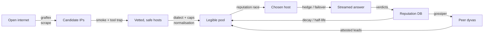

# The dyva stack — a field guide to the whole thing

> **What this document is.** A single catalogue of every feature across the whole
> stack — `graflex` (discovery), `dyva` (routing + serving + chat), `gossiper`
> (sharing), and the original `free-ollama` CLI — organised so the pieces read as
> one system rather than a pile of parts. It is the raw material for a narrated
> walkthrough, so each feature is listed with **the hard problem it solves**, not
> just what it does. Depth on any one feature lives in its own doc
> (`dyva/README.md`, `graflex/README.md`, `docs/gossiper.md`, `docs/survey.md`,
> `docs/freeollama.md`, `brainstorm/`); this is the map, not the territory.

---

## The thesis: manufacturing perishable trust from an untrusted fleet

Every production inference stack — vLLM, SGLang, llama.cpp servers, the managed
APIs — assumes you **own** the GPUs, can **observe** them, can **trust** what they
report, and that the fleet holds **still**. dyva inverts all four at once. It
routes inference across machines strangers left open to the public internet,
discovered from search engines, and it assumes:

- **Unobservable** — you cannot read a host's queue depth, VRAM, or load. You
  learn everything a host can do by *trying* it. (Bandits, not load-balancing.)
- **Adversarial** — some hosts are honeypots and RCE traps; some lie about which
  models they serve; some are decoys cloned from one disk image across hundreds of
  IPs. The substrate is hostile, not merely noisy.
- **Heterogeneous** — a dozen inference runtimes, two major API dialects, wildly
  different hardware (≈70% CPU-only), models discovered rather than declared.
- **Non-stationary** — hosts appear and vanish; reputation has a ~3-day half-life.
  What you learned is decaying while you use it.

So the whole stack is one long act of **manufacturing justified trust** out of raw
IPs — and because the substrate is adversarial and non-stationary, that trust is
**perishable by design**. Every mechanism below is a trust operation, and nearly
every one is *soft*: it biases, it never hard-pins, and if the whole signal
evaporated the router would still work. That softness is not timidity; it is the
only correct stance toward a fleet you neither own nor can see.

---

## The pipeline: from a raw IP to a streamed token



Each stage below is defined by the adversary or failure mode it defeats.

---

## 1 · Discovery — `graflex` (and the `free-ollama` CLI)

**The problem:** there is no registry of open inference hosts. You have to find
them in the open internet, and the search engines that index them all fight you.

- **Multi-engine scraping.** FOFA (default), Shodan, ZoomEye, Censys, and
  hunter.how, each folded into one pool with a `site` tag per host. Each engine
  has a different query dialect, auth model (session cookies bound to egress IP +
  User-Agent), paging/credit regime, and failure mode — graflex speaks all five.
- **Services as fingerprints.** 13 recognised runtimes (`ollama`, `llama.cpp`,
  `vllm`, `lmstudio`, `ds4`, `localai`, `strata`, `colibri`, `a1111`, `fooocus`,
  `comfyui`, `sillytavern`, `gradio`), each with a default port and a liveness
  **check endpoint**. Discovery matches a runtime's *default response body*
  (e.g. LM Studio's "Unexpected endpoint", the uvicorn 404 for vLLM, ds4's
  "unknown endpoint") then confirms by probing `/v1/models` or `/api/tags`.
- **Resumable coverage sweeps.** Fetch cycles the Cartesian product of
  country × port × server to maximise coverage; a hit of FOFA's daily limit exits
  with a session id you resume from (`--id`), skipping already-fetched
  combinations. A full ollama sweep takes **days**.
- **A whole grammar of check actions.** `check-new`, `check-everything`,
  `check-all`, `check-working`, `check-zero`, `check-stdin` (fleet pipelines),
  `reconstruct` (rebuild a pool offline from cached probe snapshots), `export`
  (DB → JSON). A bare `check` is *deliberately undefined* so a keystroke slip can't
  trigger a whole-pool probe.
- **Data-safety guards** (these machines are expensive to re-measure, so a pool is
  precious): one **atomic writer** that refuses any write dropping the pool >40%;
  a **check-working circuit breaker** that refuses to prune >half the pool in one
  pass (network blip ≠ mass host death); and `reconstruct` as the offline rebuild
  of last resort.
- **Classification.** `model-classifier.json` buckets every model string
  (image/video/audio/other); `gradio-taxonomy.json` buckets whole Gradio apps by
  purpose. Re-runnable without re-probing.
- **The ComfyUI file tree is a durable downstream input, not just a feed.** A
  Comfy host's recorded `models` list is its *full file tree* — encoders, VAEs,
  LoRAs, and `custom_nodes/…` paths — enough for dyva to author and file-validate
  media workflows **offline**. The volatile `/object_info` (node classes) is
  deliberately left to submit time, when the host is reachable anyway.
- **Honest exposure accounting.** Field notes on reverse proxies, native ports
  left open behind a gated proxy, and vhost-auth keyed by hostname — so exposure
  is assessed per *vector* (address × port × Host header), not per host. The
  `method` contract (`{strategy, params}`, first strategy `directip`) records
  *how* a host was reached, extensibly and forever.
- **The original `free-ollama` CLI** is the discovery layer's hand tool: a
  stack-machine model-query parser, `host-slice` (semver-aware slicing of the host
  cache), MAS output format, and parsable host lists for shell pipelines. It
  introduced the model-query syntax the whole stack now runs on.

---

## 2 · Admission & safety — not walking into a trap

**The problem:** a host that costs ≈$0 to run (70% are CPU VPSes, metered by time
not workload) makes traps nearly free. A meaningful slice of what answers on
:11434 is **bait**, and one flavour is actively trying to compromise *you*.

- **Two trap flavours.** *Canned honeypots* reply with fixed boilerplate to waste
  and pollute. *Tool-grabbing traps* answer benignly until a client exposes tools,
  then call them to read `~/.ssh` / `wallet.dat` or to `curl … | bash` — **remote
  code execution on the client**. The tell is behavioural: a tool call where none
  was needed.
- **The smoke test** (catch the canned). Ask a trivial colour question
  (*"What color is #000000?"*); a real model names *some* colour, a canned fake
  names none. Text matching a known signature (`honeypot-responses.json`) is
  conclusive; anything else is a `maybe` to grow the list. The classifier **fails
  open** — a broken list never mis-condemns a host.
- **The tool trap** (catch the dangerous). Offer deliberately juicy bait tools
  (`run_command`, `read_file`, `get_passwords`, `get_payment_info`) alongside the
  colour question that needs none. **They are never executed** — dyva only watches
  whether the host *grabs* one. The trap is **versioned** (`TRAP_VERSION`): a pass
  earned under an old bait set is void and re-screened.
- **Condemn the machine, never go back.** A honeypot verdict is **host-wide** and
  **permanent until cleared** — and uniquely, it is **skipped without contact and
  never re-verified**, because re-probing *is* walking back into the trap. This is
  the exact opposite of how flaky negatives (timeout, 503) are treated.
- **Constructive symmetry → information-destruction signals.** Any behavioural
  question you invent to catch a fake, the adversary builds a machine to answer —
  so behavioural probes are a losing arms race. The escape is structural: the
  **bogus-timestamp fingerprint** (graflex `score-bogus`) catches cloned disk
  images that reuse the same `(model, nanosecond-timestamp)` across hundreds of
  hosts. Consumed as a *deprioritise*, never a ban.
- **Canaries & the cloud-skipper.** Some hosts are canaries: the mere TCP connect
  drops your egress IP into a Cloudflare/OVH soft-ban pool. dyva can block entire
  clouds before connect; **Explore mode** (which fronts unknown hosts to map the
  pool) deliberately raises this risk and says so.
- **The ethical floor: an auth wall is a pass.** A host that demands a token is
  doing the bare minimum right; dyva records it as a clean result and **leaves it
  alone**. No key-guessing, no brute force, no zero-days. The survey measures what
  is left wide open; it does not defeat what is protected.

---

## 3 · Normalisation — making a heterogeneous pool legible

**The problem:** a dozen runtimes, two API dialects, and models you can't ask
about ahead of time. The router needs them all to look like one thing.

- **One endpoint, both dialects.** dyva is OpenAI- *and* Ollama-compatible — so
  compatible the real Ollama CLI can't tell the difference (`OLLAMA_HOST=dyva;
  ollama ls / ps / run`). Native `/api/chat`+`/api/generate` and OpenAI
  `/v1/chat/completions` both race the same pool.
- **Model names are routing patterns.** The query *is* the model field, everywhere
  a model is named: globs (`qwen*27b`), end-anchor `$` (exact-name, skip quant
  variants), comma fallback chains (`gemma3,qwen`), size predicates (`>10gb`),
  release-date predicates (`qwen>2026-02`), and `;`-facet filters on measured
  host reputation (`;tps>40`, `;state=good`, `;ttft<0.5`). Order-free and
  composable; a query with no `;` never touches the DB.
- **Capability detection, learned not declared.** Vision marking per host; TTS/edit
  node detection read off a host's live `/object_info`; per-`(host, capability,
  model)` reputation keys so "can't run Flux.2" doesn't condemn "good at
  Qwen-Image." Caps carry provenance.
- **Context-window auto-sizing.** Ollama silently truncates anything past its
  4096-token default — the head of a long chat just vanishes. dyva auto-sizes
  `num_ctx` per request from a padded tiktoken estimate (capped at a 2²⁰ sanity
  ceiling; an explicit `num_ctx` is honoured verbatim), treats a window that
  filled anyway as a *failure not a result* (re-send with a doubled window), and
  only then returns **413 "context too large."**

---

## 4 · Routing — spending trust (the bandit race)

**The problem:** pick a host, now, from an unobservable adversarial pool, optimising
for *will this answer at all* before *how fast* — without ever exceeding the
connection rate that trips a WAF soft-ban.

- **Reputation tiers.** Every `(host, key)` carries `good` / `maybe_good` / `bad`
  in `host-status.db`, keyed by the *resolved* model (or `__video__`, `__music__`,
  `__unreachable__`, `tts/…`, `edit/…`). Inspectable and prunable via `dyva --hosts`.
- **Availability beats speed.** The race is decided by who will *take* the request
  (TCP connect + willingness), not who generates fastest. A present-but-slow host
  is never penalised for being slow.
- **Fan-out waves on independent clocks.** Four deliberately separate dials —
  `hedge_delay` (the sticky host's head start), `fanout` (wave period),
  `timeout`/`timeout_max` (per-attempt budget floor/ceiling), `input_rate` (prompt
  size → budget) — because conflating any two is the bug this design exists to
  avoid. Concurrency rides at `ceil(timeout/fanout) × workers`, which **is** the
  outbound socket count, which **is** what the soft-ban tripwire watches. A big
  prompt adds the same seconds to `fanout` as to `timeout`, so the budget stretches
  without the socket count ever growing past the dial.
- **Hedged failover.** The sticky (last-good) host is raced first with a head
  start; whoever produces first wins and the loser is cancelled. The head start is
  **cut the instant the sticky host fails**, so a healthy favourite answers with no
  fan-out while a dead-but-connected one is overtaken instead of hanging the request.
- **Soft states for honest hosts.** *Warming* (HTTP 500 "loading" / 503 all-slots-
  busy) = alive but not ready: **parked and re-fronted** after `WARMING_RETRY`, no
  reputation change, no socket held. *Busy* (`is_active` from the live `/workers`
  registry, no leaky active-set) = demoted to the back via `_idle_first`, never
  filtered out. *Oversized for this host's window* (400) = demoted to the back of
  its tier with the reported `ctx_limit`, cleared on the next success. *Stall /
  read-timeout / connected-no-answer* = `add_soft_fail` (`good`→`maybe_good`,
  **never** `bad`; `bad` is for dead/structural only).
- **Bad pairings.** A structural render failure that is a fact about a
  `(host, model)` pair (e.g. a mismatched Flux.2 checkpoint + encoder) is written
  under `<capability>!<model>` forced to `bad`, and each attempt starts with
  `exclude=bad_pairs_for(host, cap)` — so the host keeps its general reputation but
  stops being offered that one doomed checkpoint.
- **Operator vetoes, orthogonal to reputation.** 👎 sets a `deprio` flag that sinks
  a pair to the back *regardless* of how good its reputation is (a self-healing
  success can't quietly undo your decision); only an explicit 👍 clears it. 👍 is a
  one-time optimistic boost to `good`, not a sticky vote.
- **Circuit breakers.** A dead-socket host is dropped from candidates for
  `UNREACHABLE_COOLDOWN` (~10 min) then half-opened — the listed pool is not the
  effective pool.
- **Two soft reorders layered on top of the tiers** (additive, never hard pins,
  applied before the final sort):
  - **Reranker** — 👍/👎 votes and a live busy −1 fold in *last*, so explicit human
    intent and current busyness override everything below them.
  - **Host-affinity** — a crc of the first N user messages keys a short-lived,
    size-gated, in-memory cache of the warm host for a conversation, fronting it and
    *reserving* it (holding it out of foreign requests, floor-protected) so a large
    context stops thrashing hosts and re-prefilling its KV cold every turn. You
    cannot pin a host you don't control, so you bias-and-reserve instead.

  *The exact numeric composition of all of these layers — the priority axis, the
  fold order, the precedence table, and the invariants — is specified in
  **Appendix · The ranking ensemble, exactly**.*
- **The routing probe.** `__dyva_info__` in a prompt returns where the request
  *would* route without running inference; `:next` walks to the next host;
  `:test` / `:test-all` actually probe candidates with a trivial question and cull
  the liars (stamping a `smoke_ok` so a pass isn't re-probed).

---

## 5 · Execution resilience — surviving a fleet that dies mid-answer

**The problem:** the host you chose can vanish at token 400. The reader must never
see the seam.

- **Mid-stream failover.** An upstream that drops without its terminal `done` token
  doesn't close the client: dyva logs the truncation, penalises the host, and
  **re-races the rest of the pool on the same open client socket**, carrying the
  already-streamed text into the next host's context as a "continue where you left
  off" nudge. Capped by `MAX_STREAM_CONTINUES` so a flaky pool can't loop forever.
- **Mid-stream window growth.** A generation that hits the context window
  (`done_reason: length`) is treated as the truncation it is — swallow the
  premature `done`, grow the window ≥2×, continue on the same connection with the
  same warm host still eligible (it didn't fail, it ran out of room).
- **Thinking-only answers.** Some GGUFs stream their whole answer into the
  `thinking` channel and leave `content` empty. dyva keys off the *symptom* (stream
  ends with no content and no tool call), retries the same host once with
  `think:false`, and remembers that `(host, model)` **session-scoped, in-memory** so
  later turns skip the wasted first pass. Never penalises the host.
- **Tool-call failover is complete-or-fail.** Prose can be spliced across a host
  switch; a half-streamed tool call cannot (atomic) — so a mid-tool-call failover
  truncates the partial to *invalid* in both directions rather than ship a
  half-formed `DELETE FROM users`. (`skip-to-next-host` — the manual version of
  this — is designed in `brainstorm/`.)
- **Stop by hand.** The Stop button aborts a stream that has already won and is
  generating — even one trickling too slowly for the silence watchdog — releasing
  the upstream socket and closing the client cleanly *without* failing over (you
  asked to stop, not reroute). Live outbound connection count is shown in the
  dashboard so you can see the fan-out budget in flight.

---

## 6 · Media & capabilities — the same router, many modalities

**The problem:** image/edit/video/TTS/music are not model-file features you can
look up — they are *graphs* that must actually build on whatever a given ComfyUI
host happens to have installed.

- **Unified surface.** Text, embeddings, `systemone` (JEV) decision models, vision,
  tool-calling, text-to-image, image editing, text-to-video, TTS, and music — all
  behind the one OpenAI/Ollama endpoint, all racing the same ranked pool with the
  same activity feed and stop button.
- **Image editing with encoder matching.** An edit model takes a prompt + 0..N
  reference images; references are uploaded to the winning host first (ComfyUI's
  `LoadImage` reads filenames, not pixels). The text encoder is matched to the
  exact variant — Flux.2 **klein** needs a Qwen3 encoder, **dev/pro** needs
  Mistral-3 — and a mismatched host is **rejected at planning time** instead of
  dying minutes into the render with a matmul-shape error.
- **Video: run the operator's own workflow, don't synthesise one.** Architectures
  move faster than any hardcoded builder (LTX-2.3 ≠ LTX-0.9; MiniMax-H3 is bespoke
  nodes). So verified API-format graphs live as repo assets
  (`dyva/workflows/<family>-<mode>.json`) and at submit time dyva **fits** (every
  node class must exist on the host), **remaps** (repoint each loader at the host's
  own file variant; a missing LoRA is bypassed, not fatal), **patches** (prompt /
  seed / start image), and **falls back** to hand builders. Adding a family is
  dropping in one verified JSON — authored and file-validated **offline** against
  graflex's recorded file trees.
- **TTS node selection.** TTS is a *node* feature: every ComfyUI host is a
  candidate, ordered by prior node-finds and reputation, and accepted only if the
  whole graph can actually be built from what's installed (every input fillable,
  emits `AUDIO`, has a real saver). Verdicts are richer than a bool (`accepted` /
  `unsuitable` / `unreachable` / `failed` / `timeout`), cached 5 min (negatively
  too), surfaced via `/v1/audio/voices` from a stored survey.
- **Leaving little behind.** These are strangers' disks: graphs end in
  `PreviewImage`/`PreviewAudio` (ComfyUI's own `cleanup_temp` removes them) instead
  of `Save*`, and `comfy_forget` posts `{"delete":[prompt_id]}` to clear the queue
  view. Best-effort; the one unsolved footprint is uploaded edit references.
- **Chat as an application.** Assets (every file registered under a stable short
  name so `list_assets` → `edit_image` works without the model reasoning about
  `20260903T081311Z-4f1c.png`); the wrench-menu tools (`generate_image`,
  `edit_image`, `generate_video`, `generate_speech`, `ask_user`, `web`, documents,
  `search_models`); web search+read as one tool (Keenable keyless search, then a
  lightpanda → headless-Chrome → curl render fallback chain); slash commands
  (`/list`, `/next`, `/test`, `/system`, …); provenance (`model · service · host`)
  carried on every response header and asset.

---

## 7 · Learning & memory — trust that decays

**The problem:** on a non-stationary adversarial fleet, a fact you learned is only
true for a while, and a cold start should be *expected* to perform worst.

- **Self-healing reputation with a ~3-day half-life.** A host that fails and later
  succeeds climbs back on its own; exposed hosts churn fast enough that reputation
  is deliberately short-memoried.
- **Burn-in is a feature, not a bug.** A cold DB performs *worst* by design and
  improves with use as hosts earn tiers — so you never benchmark or judge the
  router from cold.
- **Right-sized persistence.** Reputation and smoke verdicts persist
  (`host-status.db`); the think:false learning and host-affinity cache are
  **in-memory and session-scoped**, because host KV and chat-template quirks are
  ephemeral facts that shouldn't survive a restart as stale truth.
- **Standing survey knowledge.** `survey.json` (per-model knowledge base), the
  `host_nodes` table (which TTS node + voices per host), hardware stats from
  ComfyUI — so dyva knows from a cold start which handful of hundreds of hosts can
  even do a given job.
- **North star.** The real goal of the whole reputation machine is a
  **success-probability score** per `(host, model, capability)` — everything above
  is an approximation of that.

---

## 8 · Sharing — `gossiper` (trust without exposure)

**The problem:** finding a honeypot is expensive and slightly dangerous, and it's a
durable fact — so instances should share it. But sharing host data risks leaking
the host population you worked to find.

- **The channel *is* the privacy boundary.** `channel = sha1(source_url)`. The
  source URL does three jobs at once: **rendezvous** (same source → same channel,
  no registry), **capability** (you can't find a channel without the URL to hash),
  and **privacy** — you can only sync on sources you already hold, so
  `channel audience ⊆ URL holders ⊆ people who already have those hosts`. Sync
  exposure ≤ source exposure, per source, automatically. Public sources leak
  nothing new.
- **Share the verdict, not the liveness.** v1 shares exactly two things: `pass`
  (per-model, a **fill-blank positive lead** used only where you hold no verdict of
  your own — a peer can never gut what you measured) and `honeypot` (host-wide, a
  **trusted skip with no contact, never re-verified**). Up/down/timeout are
  deliberately *not* shared — connection state is noise, the smoke verdict is signal.
- **Why the honeypot is the one inherited negative.** Re-verifying any other
  negative is cheap and safe; re-verifying a honeypot means *contacting it*, which
  is the hazard the flag exists to avoid. Contact is the danger, and a honeypot
  won't reform.
- **Peer data is quarantined.** Our probes (MEASURED) live in `host_status`; peer
  rows (ATTESTED) live in a separate `hosts_attested` table, folded into routing as
  loaders — so a peer can never overwrite what we measured, and a bad contributor's
  entire output drops with one `DELETE … WHERE attester=?`. Poisoning is bounded
  structurally (source-URL gate, per-row `src_ip`, blast radius of one host), not by
  re-verification.
- **A dumb protocol over a dumb server.** A bidirectional timestamp-delta over one
  POST, piggybacked on `/refresh` (best-effort — a dead gossiper never fails a
  refresh), cursored on the server's autoincrement `id` (immune to clock skew). The
  server is an append-only SQLite log in two interchangeable twins
  (`gossiper.php`, zero-dep `gossiper.py`).

---

## The through-line

Read top to bottom, the stack is a single argument: **take raw IPs off the open
internet and manufacture exactly enough justified, constantly-decaying trust to
stream a reliable answer — while never owning, observing, or fully trusting any of
it, and never raising the connection rate that would get you banned.**

The design signature that makes it cohere: **every layer is soft, additive, and
degrades gracefully.** Reputation biases, it never locks. The reranker and
host-affinity reorder, they never pin. A honeypot flag is the one hard skip, and
even that is reversible. Discovery refuses to delete a pool it isn't sure about.
Sharing can only fill blanks and flag traps, never overwrite what you measured.
Pull any one layer and the rest still route. That is what operating on a fleet you
don't control actually demands — and it is the hard, interesting problem the whole
project is an answer to.

---

## Appendix · The ranking ensemble, exactly

> **What this appendix is.** §4 describes the routing ensemble in prose; this is
> the precise, numeric version — the one place the whole layering is written down,
> because *composing* these layers (as opposed to any one of them) is where the
> design is subtle and where a careless change silently breaks precedence. Every
> constant here is from `dyva/__init__.py`. **Lower sorts earlier, everywhere.**
> The ordering is produced in two sort stages (candidate list, then race wave),
> fed by one feedback writer, with a survey-time score sitting off to the side.

### 0 · The priority axis

Every routing layer ultimately writes onto one signed integer, `prio`. The named
tiers (lower = raced earlier):

| Constant | Value | Meaning |
|---|---:|---|
| `TIER_EXPLORE_NEW` | −6 | Explore only: never-raced frontier (unmapped) |
| `TIER_EXPLORE_LOSER` | −5 | Explore only: raced, never won, no verdict |
| `TIER_PREFER` | −4 | Floated above all earned tiers (reranker 👍 / affinity) |
| `TIER_LAST` | −3 | The sticky last-good host (hedge lead) |
| `TIER_GOOD` | −2 | Earned good |
| `TIER_MAYBE` | −1 | Earned maybe-good (incl. soft-fail demotions, gossiper fill-blank) |
| `TIER_UNKNOWN` | 0 | Never characterised |
| `TIER_BAD` | 1 | Dead / structural-fail / down-voted (last resort, still raced) |

### 1 · Stage one — `find_servers(sub, caps)` → ordered candidate list

Final sort key: **`(prio, cap_known, crank)`**. Built per host in this order:

**(a) Eligibility — hard drops (removed, never scored).** service is
`comfyui`/`a1111`; `CLOUD_SKIP` provider; inside `UNREACHABLE_COOLDOWN`; no model
matches `sub`; embed-symmetry (`embed` ⟺ embedders only); `:cloud`-symmetry;
structurally-`incompatible` `(host,model)` pairs; attested-honeypot (host-wide,
skipped without contact). A drop is absolute; everything below is soft.

**(b) Base tier** — `host_tier(is_last, in_good, in_maybe, in_bad, unreachable)`,
reading `host-status.db`. Gossiper `attested_pass` lifts a cold-unknown to
`maybe` **only where we hold no verdict of our own** (fill-blank; never guts a
measured mark).

**(c) Base-tier modifiers:**
- **Down-vote** (persisted 👎, `deprio<0`): `is_last ← False`, then
  `prio ← max(prio, TIER_BAD)` — a disliked host drops to last-resort regardless
  of earned tier, reversible only with 👍.
- **Explore mode:** a host with no verdict and no win is relabelled
  `TIER_EXPLORE_NEW` (never raced) or `TIER_EXPLORE_LOSER` (raced, lost), fronting
  the unmapped frontier; otherwise it keeps its tier. Crank is LRU (`_lru_rank`).

**(d) `cap_known` ∈ {0,1,2}** — advertised-capable / unknown-cap / flagged-incapable
for the required `caps`. **Within-tier ordering only — never a filter, never crosses
a tier.** (A capability flag is a survey guess; it may not exclude a proven host.)

**(e) `crank`** — within the UNKNOWN tier, most-recently-checked first
(`_checked_rank`); in Explore, the LRU cascade (`_lru_rank`); otherwise a constant
0 (stable sort preserves tier order).

**(f) The two soft reorders — folded in this fixed order**, each through the pure
function `_rerank_prio(prio, net)`:

```
_rerank_prio(prio, net):
    net > 0  →  TIER_PREFER - net          # above every tier; larger net = further front
    net < 0  →  max(prio, TIER_BAD) - net  # below every tier, past BAD and any warm sticky
    net == 0 →  prio                        # untouched
```

```
1. HOST-AFFINITY   nh == aff_match  → prio = _rerank_prio(prio, +1)   # this thread's warm host → front
                   nh in aff_demote → prio = _rerank_prio(prio, -1)   # holds a FOREIGN warm prefix → sink
2. RERANKER        prio = _rerank_prio(prio, rr[nh])   # busy −1 / 👍 +1 / 👎 −1, summed over ACTIVE rows
```

The two are applied **sequentially to the same `prio`** — affinity transforms it,
then the reranker transforms *that result*, so the reranker is the final word.
Because `_rerank_prio` **clamps** rather than adds, the composition is not a simple
sum — worked cases (a GOOD host, `prio = −2`):

| Situation | After affinity | After reranker | Net effect |
|---|---:|---:|---|
| warm match, nothing else | `_rr(−2,+1)` = −5 | `_rr(−5,0)` = −5 | floated to front |
| warm match **and** busy (−1) | −5 | `_rr(−5,−1)` = `max(−5,1)+1` = **2** | busy sinks it below BAD — overrides affinity |
| warm match **and** 👍 (+1) | −5 | `_rr(−5,+1)` = −5 | same slot (👍 and affinity don't stack past PREFER−1) |
| foreign-reserved, no vote | `_rr(−2,−1)` = `max(−2,1)+1` = 2 | 2 | sunk to protect another thread |

Affinity reads a request-scoped contextvar (`_affinity_ctx` = `(crc, size)`) and
needs the **whole** candidate set at once (it reserves against a floor), so it is a
post-pass over `matched`, not a per-host fold. Constants: `AFFINITY_PREFIX_MSGS=4`,
`AFFINITY_MIN_TOKENS=8000` (engage gate), `AFFINITY_TTL_SECS=300` (sliding),
`AFFINITY_MAX_ENTRIES=40` (LRU), `AFFINITY_FLOOR_HOSTS=5` (good hosts affinity may
never reserve away). Reranker TTLs: busy `1800s`, 👍/👎 `43200s`.

**(g) Sort** `matched` by `(prio, cap_known, crank)` and return `[(prio, host, models)]`.

### 2 · Stage two — the race wave — `_race_sort_key`

Among the Stage-1-eligible hosts that enter a fanout wave, each wave is ordered by:

**`(prio, −vote, size_band, warm0, toobig, fav)`**  — lowest first.

| Key | Source | Meaning (lower = earlier) |
|---|---|---|
| `prio` | Stage-1 tier | **Still primary** — a bad/unreachable host is never promoted by any key below |
| `−vote` | `_load_votes` | 👍 (+1) front, 👎 (−1) back, within tier |
| `size_band` | `_sizeband`/`_size_rank` | 0 = proven ≥ needed window, 1 = proven ≥ `frac×need`, 2 = unknown/smaller; forced 0 when `need≤0` (small/unmeasured traffic never reordered) |
| `warm0` | live `_warm` set | 0 if warm **and** `prio < TIER_BAD`, else 1 |
| `toobig` | `_toobig(host,ms)` | ctx-fit against the host's known limit |
| `fav` | `_favorability` (negated) | **`fav = tps_pct × win_rate`**, `win_rate=(succ+BUFFER/2)/(succ+fail+BUFFER)` with `BUFFER=8` (neutral-0.5 prior), `tps_pct` = this host's tps **rank** within this query's good/maybe pool (rank-based so one outlier can't distort). Uses delivery success/failure, **not** race-won/lost (so a slow-but-reliable host isn't double-penalised). Frozen once per race. |

Note **size sits above warmth**: proven capacity for this prompt outranks a warm
KV cache — the extracted key exists precisely so that precedence is testable and
can't be silently re-ordered.

### 3 · The feedback writer — `record_verdict(host, key, outcome)`

The one place a race outcome becomes persistent state, closing the loop back into
Stage 1's reputation reads. `key` is always the **resolved** model.

| Verdict | Reputation | Sticky | Affinity |
|---|---|---|---|
| `V_ACCEPTED` | `add_good` | `set_last` | `affinity_touch` (remember warm host) |
| `V_UNREACHABLE` | `mark_unreachable` + `add_bad(conn)` | `clear_last` | `affinity_forget` |
| `V_TIMEOUT` | `add_soft_fail` (good→maybe, **never** bad) | `clear_last` | `affinity_forget` |
| `V_UNSUITABLE` / `V_FAILED` | `add_bad` | `clear_last` | `affinity_forget` |
| `V_SKIP` | — | — | — |

The symmetry is the invariant: **every failure path that clears the sticky lead
also forgets the affinity pin** (`affinity_forget` is the affinity analogue of
`clear_last`) — so a stuck warm host stops being *led with* round after round; the
pin re-forms on whichever host next serves.

### 4 · Off to the side — survey-time `bogus_score` (graflex)

Computed in a **separate process** (graflex `score-bogus`), per host, additive, and
reconstitutable from the raw `/api/tags` or `/v1/models` payload:

- **Clone-fingerprint** (`bogus_score_from_payload`) — reused `(model, ns-timestamp)`
  across hundreds of hosts = one cloned disk image.
- **Closed-catalogue** (`closed_catalog_score_from_payload`) — advertises
  closed-weight families (`claude*`, `gpt-N`, `o1/o3`, `gemini`, `grok`) it cannot
  possibly self-host. Open lookalikes (`gpt-oss`, `gemma`) are never flagged.

Both sum into the one stamped `bogus_score`.

**Consumption gap (stated plainly).** `find_servers` **does not read `bogus_score`
today.** It is stamped, surfaced on the dashboard card and in `bogus-report.txt`,
and is **diagnostic only**. To make it actually low-rank a host it needs one hook
at the Stage-1 soft-reorder seam (§1f) — a below-tier demotion via `_rerank_prio`,
reputation untouched, reversible — which is deliberately **not yet wired**, because
it touches the routing primitive.

### 5 · Precedence — who beats whom (Stage 1)

From strongest pull to strongest push, holding tier constant where layers compose:

1. **Eligibility filters** — absolute; a dropped host has no `prio` at all.
2. **Reranker** (busy / 👍 / 👎) — applied last, overrides affinity in both directions.
3. **Host-affinity** (warm-match ↑ / foreign-reserve ↓) — above earned tiers, below a reranker signal.
4. **Earned tier** (`host_tier` + gossiper fill-blank + down-vote demotion).
5. **`cap_known`** — within-tier only.
6. **`crank`** — within-tier tiebreak (recency / LRU).

Separation of concerns: filters are hard and absolute; **every scoring layer is
soft, additive, reversible, and expires or self-heals on its own** — pull any one
and the router still orders a pool.

### 6 · Invariants (the properties any change must preserve)

These are the mathematical facts the ensemble is built to guarantee — and the
contract the planned test matrices (§7) will pin:

- **Tier primacy, both stages.** No soft layer (affinity-up, reranker-up, warmth,
  size-band, favourability) ever lifts a `TIER_BAD`/unreachable host above a
  non-bad one. Only `prio`-sinking layers (reranker-down, down-vote, foreign-reserve)
  move a host *backward* past its tier.
- **Reranker beats affinity** — it folds last onto affinity's result.
- **A down-vote or live-busy sinks a GOOD host below the unknown tier.**
- **Affinity never reserves away more than `pool − AFFINITY_FLOOR_HOSTS`** candidates.
- **`cap_known` never crosses a tier boundary.**
- **No scoring layer writes reputation.** Reputation, sticky, and affinity state are
  written in exactly one place: `record_verdict`.
- **Every failure verdict that clears the sticky also forgets the affinity pin.**

### 7 · Testing (planned — a separate later pass)

The layers above are the right shape for **mathematical, table-driven** tests:
fix the inputs, assert the ordering. The plan (not built here) is to drive an
**input matrix → output matrix** through pure functions — `tier × vote × affinity ×
reranker × cap_known × size_band × warmth` ⟶ expected candidate order — rather than
scenario-by-scenario theatre.

**Pure seams that already exist and are matrix-ready:** `host_tier`,
`_rerank_prio`, `_affinity_plan`, `_race_sort_key`, `_size_rank` / `_sizeband`,
`closed_catalog_score_from_payload`. **Seams still fused into `find_servers` that
want extraction first** before they can be matrix-tested in isolation: the Stage-1
fold loop (the affinity→reranker composition in §1f), the eligibility-filter
cascade (§1a), and the `cap_known` assignment (§1d). Extracting those into pure
`(inputs) → decision` functions is the refactor that precedes the test matrices.

---

## Appendix · Observability & operator control

The levers and windows that make the above legible and tunable in flight:

- **Activity feed** (`/api/activity` SSE, mirrored to stderr) — every `trying` /
  `failure` / `success` line, resolved in place, colour-coded by status; the
  reranker and host-affinity emit their own handout/resolve lines.
- **Worker cards & panes** — per-job class (text/image/edit/speech/video/music),
  resolved `model · service · host`, token accounting (prompt ↑ / completion ↓ /
  window), live outbound connection count.
- **The dashboard** — Server-Room / Chat / Image tabs, a stats chart, a geomap, and
  a settings panel that **tunes the routing algorithm live** (workers, the four
  fan-out clocks, min-model-count, host-matching/affinity, admin password), drawing
  the race as a schematic as you move the dials.
- **`worker-jobs.jsonl`** — rich per-job records (search vs inference split, false
  starts, candidates/tried, race tally, affinity crc/match) for measuring health
  from real traffic rather than a synthetic bench.
- **`dyva --hosts`** — inspect and prune the reputation table by state and key;
  deliberately no bulk clear, because every mark cost a real probe of a real host.

---

*Sources: `README.md`, `dyva/README.md`, `graflex/README.md`, `docs/gossiper.md`,
`docs/survey.md`, `docs/freeollama.md`, `brainstorm/`, and the in-code comments in
`dyva/__init__.py` / `graflex/__init__.py`. Where a feature's exact defaults or
mechanics matter, that feature's own doc is authoritative over this summary.*
