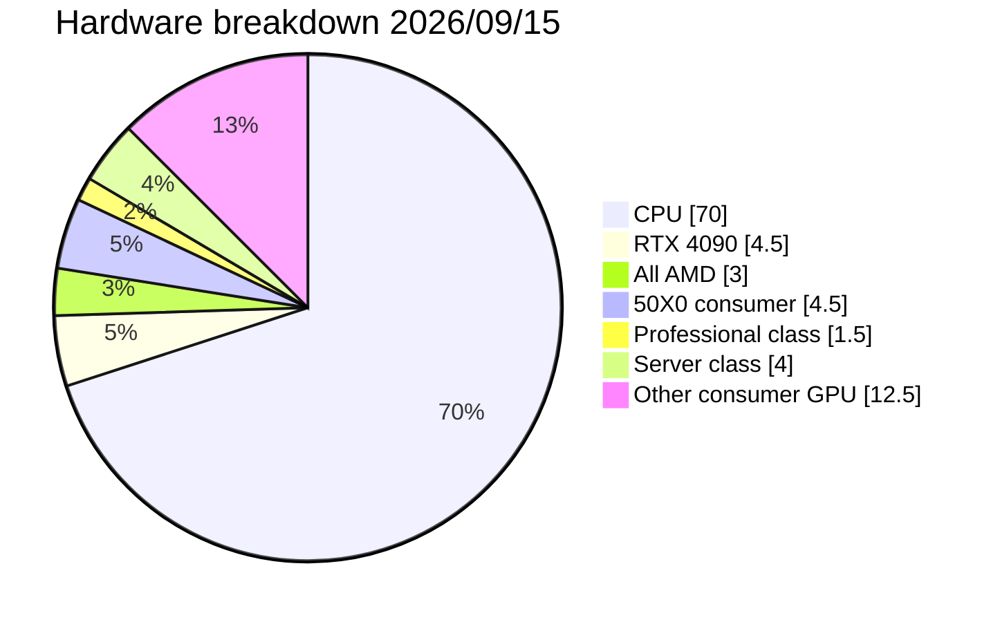

## What's actually out there?

Some of the surveys reveal hardware specs and it's mostly CPU, about 70%. This makes economical sense: A cheap VPS is about 1/70th the cost of a decent GPU but only about 1/7th the inference speed.

This means the median inference cost of a single request is about `$0.00007` - and if you didn't make the request, they'd still pay that because it's metered by time, not by workload. This means the actual incurred costs on the machine for the request is $0.00. Not close, but exactly.

In that remaining 30%, the venerable RTX 4090 takes the top spot with 4.5% followed by "All AMD (this survey buckets them all)" at 3% and the rest being difficult to justify any claims on given their low population density.

About 1.5% are professional class (A6000/A5000) for example, and approximately 4% are server class (L4, A100, H100, V100 etc)

