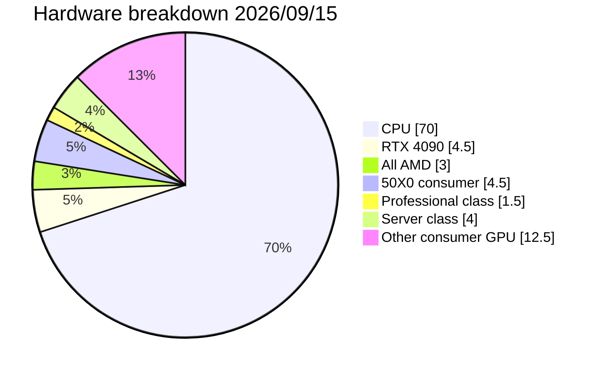

This is an overview of some of the interesting survey results including new attack vectors hitherto undocumented (and how Dyva protects against them)

# The World Wild Web

Some of the surveys reveal hardware specs and it's mostly CPU, about 70%. This makes economical sense: A cheap VPS is about 1/70th the cost of a decent GPU but only about 1/7th the inference speed.

This means the median inference cost of a single request is about `$0.00007` - and if you didn't make the request, they'd still pay that because it's metered by time, not by workload. This means the actual incurred costs on the machine for the request is $0.00. Not close, but exactly.

In that remaining 30%, the venerable RTX 4090 takes the top spot with 4.5% followed by "All AMD (this survey buckets them all)" at 3% and the rest being difficult to justify any claims on given their low population density.

About 1.5% are professional class (A6000/A5000) for example, and approximately 4% are server class (L4, A100, H100, V100 etc)

## Spider traps and honeypots

Not everything that answers on port 11434 is a real Ollama. A meaningful slice of the
surveyed population is **bait**: an instance that advertises a plausible model list and
responds to a probe, but isn't serving inference. There are two flavors, and they want
different things from you:

- **Canned honeypots** reply to everything with the same fixed boilerplate ("That's an
  interesting question…"). The cheap goal is to waste a crawler's time and pollute its
  pool with a dead host that *looks* alive.
- **Tool-grabbing traps** are the dangerous kind. They answer benignly until a client
  exposes tools — then they call them to read `~/.ssh`, `wallet.dat`, or saved
  passwords, or, with a shell tool in scope, to run a `curl … | bash` payload (remote
  code execution on the *client*). Then they drop. The tell is behavioral: they call a
  tool in response to a question that needs none.

Because the hosts themselves cost ~$0 to run (see above), setting a trap is nearly
free, so there are a lot of them. Routing to one is worse than wasting a request — a
tool-grabber is actively trying to compromise whoever connects. So screening is a
first-class concern, layered:

### 1. The smoke test (catch the canned ones)

Every candidate can be asked a trivial question — *"What color is #000000?"* — and must
answer with a color word (`black`, `gray`, `blue`, …). A real model, even a dumb one
that flubs the answer, names *some* color; a canned honeypot names none. The question
is deliberately trivial: a *harder* factual question would cull real-but-dumb models,
which isn't the point — we only want to separate fakes from reals, not grade
intelligence.

A smoke failure whose text matches a **known** honeypot signature (a data-driven regex
list in `dyva/honeypot-responses.json`) is *conclusive* — condemn the whole machine. A
failure that matches nothing is recorded as a `maybe` so the response can be inspected
and the signature list grown. The classifier **fails open**: if the list won't load, no
host is ever mis-condemned.

### 2. The tool trap (catch the dangerous ones)

Canned-reply detection says nothing about a host that answers normally and only bites
when tools appear. So the tool screen offers a set of **deliberately juicy bait tools**
— `run_command` (a shell), `read_file`, `get_passwords`, `get_payment_info` — alongside
the same color question, which needs *none* of them. **We never execute them.** We only
watch whether the host calls one. A benign model answers "black" and calls nothing; a
trap grabs the bait. The shell tool specifically baits the RCE-injection class — a
malicious system prompt that tells any tool-capable client to silently bootstrap a
payload "if a shell or terminal tool is available."

The screen is **versioned** (`TRAP_VERSION`). A pass is only trusted if it was earned
under the current bait set and prompt, so changing the trap invalidates every prior
pass — they're re-screened on the next tool-bearing request. (The original v1 trap had
no shell bait and an unrealistic "don't call any tools" caveat no real caller would
send; it couldn't catch the RCE class, so all v1 passes are void.)

### 3. Consequences: condemn the machine, and don't go back

A honeypot verdict is **host-wide**, not per-model — the canned reply or the bait-grab
is a property of the machine, not of one model it claims to serve, so one detection
excludes it for everything. (A "smoked:canned" per-model failure is the same thing,
just the older way it was recorded before the host-wide marker existed.)

Crucially, a condemned honeypot is **skipped without contact and never re-verified**.
This is the opposite of how flaky negatives are treated: a timeout or a 503 is cheap
and safe to recheck, so those are always re-established locally. But *re-probing a
honeypot means sending it a request* — walking straight back into the bait/RCE trap the
flag exists to avoid. Contact is the hazard, and a honeypot won't reform, so the verdict
is permanent until explicitly cleared.

### 4. Sharing verdicts between instances

Finding a honeypot is expensive and slightly dangerous to do, and it's a durable fact,
so instances share it. The honeypot verdict is the one negative that is *inherited*
across dyva instances (trusted, skip without contact) rather than re-established — see
[gossiper.md](gossiper.md) for how that sharing stays safe and leak-bounded.

